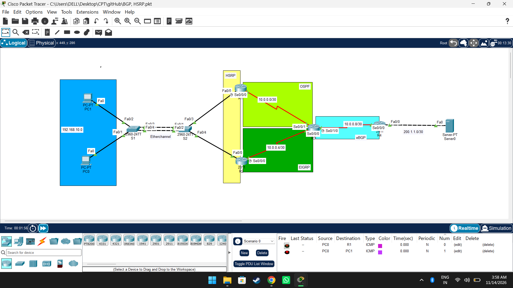

# HSRP-OSPF-EIGRP-BGP-packet-tracer
Cisco Packet Tracer lab: HSRP gateway redundancy, EtherChannel, OSPF and EIGRP with redistribution, and eBGP to an external network.
# HSRP, EtherChannel, OSPF, EIGRP and eBGP Lab (Cisco Packet Tracer)

## Overview
This project builds a redundant enterprise-style network. The LAN uses two switches with EtherChannel and two routers running HSRP for first-hop redundancy. The routers connect to a core router through OSPF and EIGRP, and an eBGP link connects to an external network that hosts a server.

## Topology

## Network Design

| Section | Technology | Details |
|---------|-----------|---------|
| LAN (blue) | EtherChannel | Switches S1 and S2 are bundled with a port-channel for link redundancy and more bandwidth |
| Gateway (yellow) | HSRP | R1 and R2 share a virtual gateway IP for the 192.168.10.0 LAN, so if one router fails the other takes over |
| Path 1 | OSPF | R1 to R3 over 10.0.0.0/30 |
| Path 2 | EIGRP | R2 to R3 over 10.0.0.4/30 |
| Edge (cyan) | eBGP | R3 to R4 over 10.0.0.8/30 |
| External network | Static addressing | R4 to Server0 over 200.1.1.0/30 |

## IP Addressing

| Network | Purpose |
|---------|---------|
| 192.168.10.0/24 | User LAN (PC0, PC1) |
| 10.0.0.0/30 | R1 to R3 link (OSPF) |
| 10.0.0.4/30 | R2 to R3 link (EIGRP) |
| 10.0.0.8/30 | R3 to R4 link (eBGP) |
| 200.1.1.0/30 | R4 to Server0 |

## Technologies Used
- HSRP (gateway redundancy)
- EtherChannel (Layer 2 link aggregation)
- OSPF and EIGRP
- Route redistribution between OSPF and EIGRP at R3
- eBGP between two autonomous systems
- Cisco 2811 routers and 2960 switches

## Objectives
- Provide a redundant default gateway for LAN users with HSRP
- Bundle the links between S1 and S2 with EtherChannel
- Run OSPF and EIGRP on separate paths and connect them at R3
- Establish an eBGP neighbour between R3 and R4
- Verify that LAN users can reach the external server

## Verification
- `show standby brief` to check HSRP active and standby routers
- `show etherchannel summary` to check the port-channel
- `show ip ospf neighbor` and `show ip eigrp neighbors`
- `show ip bgp summary` to confirm the eBGP neighbour is established
- `show ip route` to check learned routes
- Ping from PC0 to PC1, to the gateway, and to Server0 (200.1.1.x)
- Shut down the active HSRP router's interface and confirm the standby router takes over and the ping still works

## How to Open
Download the `.pkt` file (or the zip) and open it in Cisco Packet Tracer.

## Result
The LAN has a redundant gateway and redundant links, routing works across OSPF, EIGRP and BGP, and the PCs can reach the external server.
